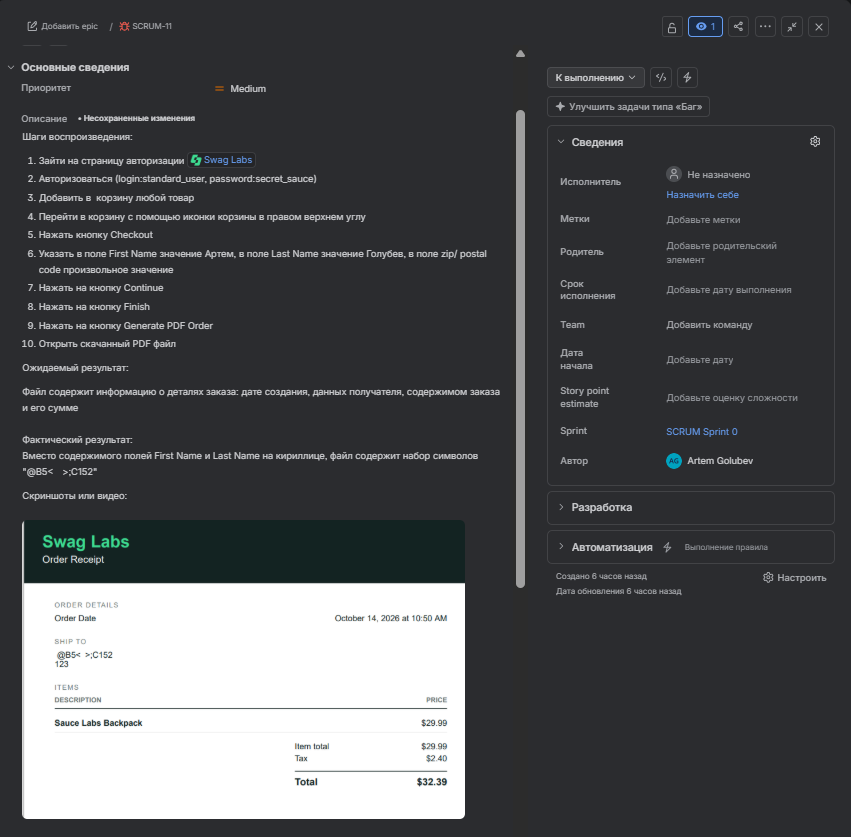

**В PDF некорректно отображаются кириллические значения полей First Name и Last Name**

**Шаги воспроизведения:**

1. Зайти на страницу авторизации [Swag Labs](https://www.saucedemo.com/)
2. Авторизоваться (login:standard\_user, password:secret\_sauce)
3. Добавить в  корзину любой товар
4. Перейти в корзину с помощью иконки корзины в правом верхнем углу
5. Нажать кнопку Checkout
6. Указать в поле First Name значение Артем, в поле Last Name значение Голубев, в поле zip/ postal code произвольное значение
7. Нажать на кнопку Continue
8. Нажать на кнопку Finish
9. Нажать на кнопку Generate PDF Order
10. Открыть скачанный PDF файл

**Ожидаемый результат:**

Файл содержит информацию о деталях заказа: дате создания, данных получателя, содержимом заказа и его сумме

**Фактический результат:**

Вместо содержимого полей First Name и Last Name на кириллице, файл содержит набор символов "@B5< >;C152"

**Скриншоты или видео:**

**Окружение:**

* ОС и версия: Windows 11 25H2
* Браузер и версия: Yandex Browser 26.8.0.0
* Тестовая среда: [Swag Labs](https://www.saucedemo.com/)

