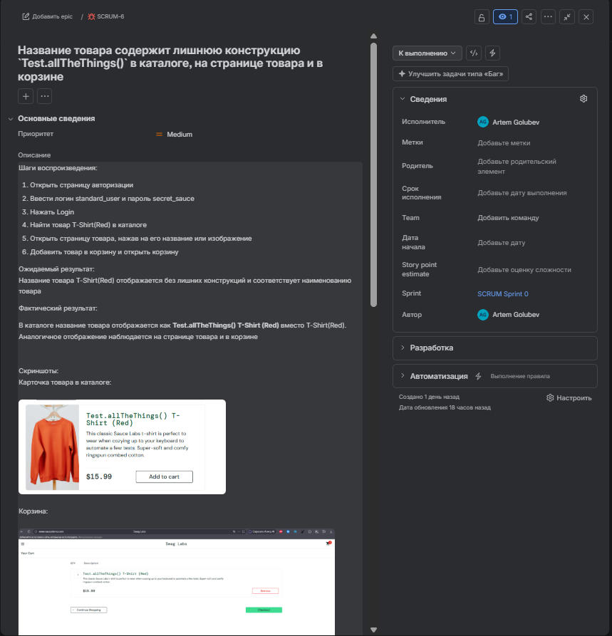
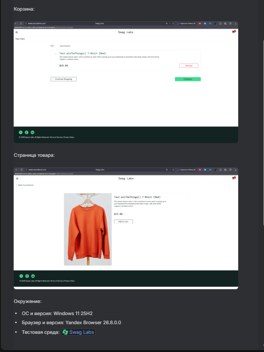

**Название товара содержит лишнюю конструкцию `Test.allTheThings()` в каталоге, на странице товара и в корзине**

**Priority: Medium**

**Шаги воспроизведения:**

1. Открыть страницу авторизации [Swag Labs](https://www.saucedemo.com/)
2. Ввести логин standard\_user и пароль secret\_sauce
3. Нажать Login
4. Найти товар T-Shirt(Red) в каталоге
5. Открыть страницу товара, нажав на его название или изображение
6. Добавить товар в корзину и открыть корзину

**Ожидаемый результат:**

Название товара T-Shirt(Red) отображается без лишних конструкций и соответствует наименованию товара

**Фактический результат:**

В каталоге название товара отображается как Test.allTheThings() T-Shirt (Red) вместо T-Shirt(Red). Аналогичное отображение наблюдается на странице товара и в корзине

**Окружение:**

* ОС и версия: Windows 11 25H2
* Браузер и версия: Yandex Browser 26.8.0.0
* Тестовая среда: [Swag Labs](https://www.saucedemo.com/)

**Скриншоты баг-репорта в Jira:**

