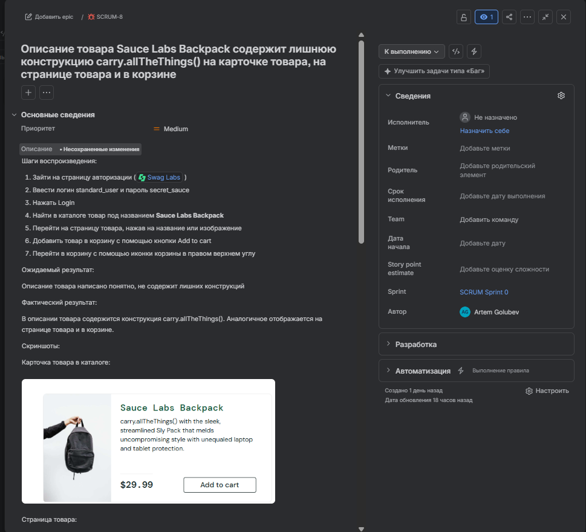
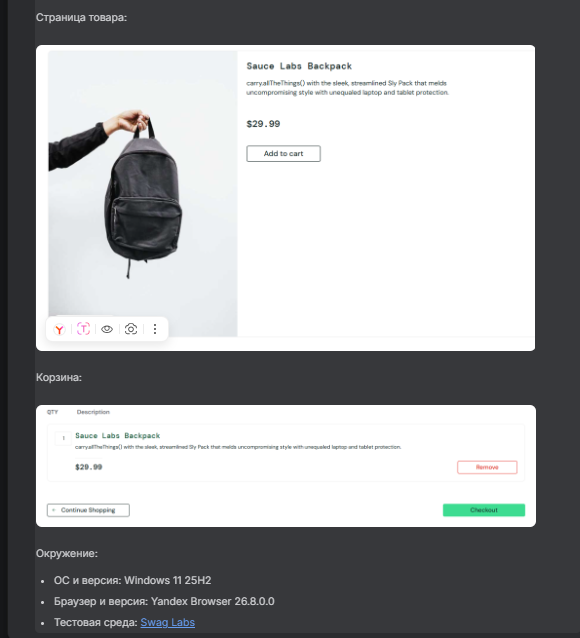

**Описание товара Sauce Labs Backpack содержит лишнюю конструкцию carry.allTheThings() на карточке товара, на странице товара и в корзине**

**Priority: Medium**

**Шаги воспроизведения:**

1. Зайти на страницу авторизации [Swag Labs](https://www.saucedemo.com/)
2. Ввести логин standard\_user и пароль secret\_sauce
3. Нажать Login
4. Найти в каталоге товар под названием Sauce Labs Backpack
5. Перейти на страницу товара, нажав на название или изображение
6. Добавить товар в корзину с помощью кнопки Add to cart
7. Перейти в корзину с помощью иконки корзины в правом верхнем углу

**Ожидаемый результат:**

Описание товара написано понятно, не содержит лишних конструкций

**Фактический результат:**

В описании товара содержится конструкция carry.allTheThings(). Аналогичное отображается на странице товара и в корзине.

**Окружение:**

* ОС и версия: Windows 11 25H2
* Браузер и версия: Yandex Browser 26.8.0.0
* Тестовая среда: [Swag Labs](https://www.saucedemo.com/)

**Скриншоты баг-репорта в Jira**

