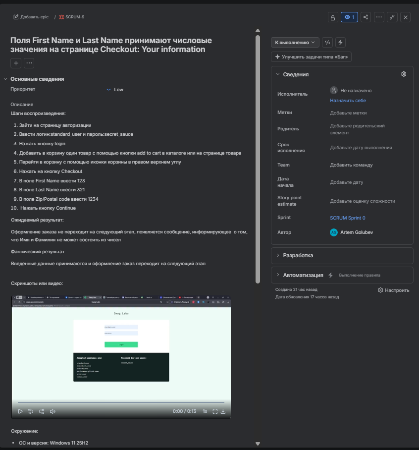

**Поля First Name и Last Name принимают числовые значения на странице Checkout: Your information**

**Priotity: Low**

**Шаги воспроизведения:**

1. Зайти на страницу авторизации [Swag Labs](https://www.saucedemo.com/)
2. Ввести логин:standard\_user и пароль:secret\_sauce
3. Нажать кнопку login
4. Добавить в корзину один товар с помощью кнопки add to cart в каталоге или на странице товара
5. Перейти в корзину с помощью иконки корзины в правом верхнем углу
6. Нажать на кнопку Checkout
7. В поле First Name ввести 123
8. В поле Last Name ввести 321
9. В поле Zip/Postal code ввести 1234
10. &#x20;Нажать кнопку Continue

**Ожидаемый результат:**

Оформление заказа не переходит на следующий этап, появляется сообщение, информирующее  о том, что Имя и Фамилия не могут состоять из чисел

**Фактический результат:**

Введенные данные принимаются и оформление заказ переходит на следующий этап

**Окружение:**

* ОС и версия: Windows 11 25H2
* Браузер и версия: Yandex Browser 26.8.0.0
* Тестовая среда: [Swag Labs](https://www.saucedemo.com/)

**Скриншот баг-репорта из Jira:**

